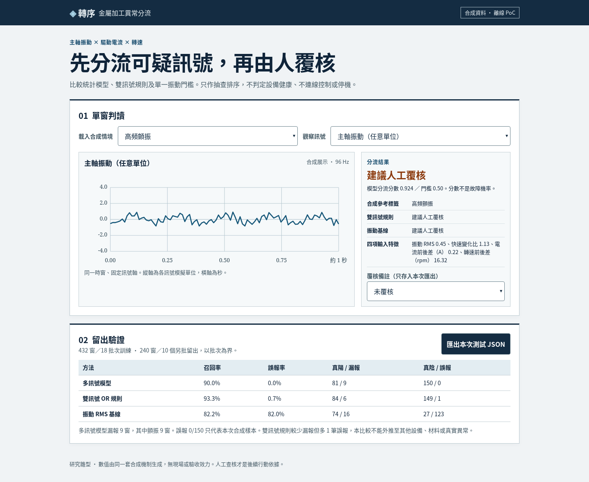

# 轉序｜金屬加工訊號分流 PoC

把主軸振動、驅動電流、轉速三條合成訊號轉成可複核的**抽查提示**。可切換情境、查看訊號、比較規則與模型、記下人工判讀、匯出 JSON。無外部服務或金鑰；不控制設備，不作安全或故障診斷。



## 操作

```bash
python3 -m http.server --bind 127.0.0.1 8000
```

瀏覽器開啟 `http://127.0.0.1:8000/`。先切換合成情境，再切換振動、電流或轉速。查看「分流結果」及底下的留出驗證，最後用「匯出測試 JSON」保存可重跑結果。模擬取樣頻率、波形與標籤只為展示，不是機台規格。

## 為什麼同時保留規則和模型

固定種子產生 18 批訓練資料（432 窗），測試另用 10 批（240 窗），同批不跨分割。固定 90 異常窗、150 非異常窗作本次留出比較。

| 作法 | 漏報／90 | 誤報／150 |
|---|---:|---:|
| 多訊號邏輯迴歸 | 9 | 0 |
| 雙訊號門檻 | 6 | 1 |
| 單一振動門檻（簡單參考） | 16 | 123 |

雙訊號規則多抓到 3 窗、代價是多 1 窗誤報。這組合成資料不支持「AI 全面更好」；真實場域應在事先約定的獨立設備、批次和工況下比較，而且要把拒判、漏報、誤報一起看。

- [研究依據及範圍](docs/research-brief.md) · [可重跑研究任務](docs/research-task.md) · [驗收紀錄](docs/validation.md)
- [可重現數據](docs/measured-results.json) · [手機實機畫面](docs/mobile.png)

```bash
node --test tests/model.test.mjs
node tests/measure.mjs | cmp - docs/measured-results.json
```

資料與演算法在瀏覽器本機執行。前端不依賴模型服務；獨立研究對照未使用 GPT Researcher SDK 或 MCP 產報。
